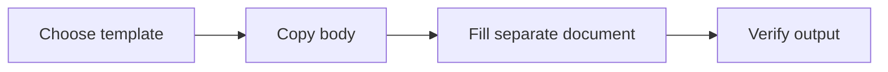

**Created by:** ChatGPT  
**Created on:** 2026-11-11 (Europe/Vienna)  
**Contribution:** Create the approved single-file Markdown template catalogue, authoring structure, and formatting reference. No private source material is included.

**Edited by:** ChatGPT  
**Edited on:** 2026-11-11 (Europe/Vienna)  
**Edit contribution:** Add a clearly labeled sample template for the authorized end-to-end workflow test; preserve the existing starter and formatting reference.

# templates

**Catalogue version:** 1.1.0  
**Purpose:** Keep reusable document templates in one readable file that people and AI assistants can use without changing the master.  
**Publication:** This file is suitable for a public repository. Store completed documents and private connection details elsewhere.

## Start here

1. Choose a template from the index and read its purpose and required inputs.
2. Copy only the content between its **Template body** and **End of template body** labels into a new document. Do not copy the whole catalogue.
3. Replace `{{placeholders}}` using verified information. State missing information; never fabricate it.
4. Apply the completion checks and save the completed document to its intended destination.
5. Leave this master unchanged. A deliberate template revision is a different operation and must be versioned and published.

The named file `templates.md` is a stable entry point. Versions belong inside the document and in Git history, not in a changing filename. There is one master catalogue, not one independently edited copy per application.

## Template index

| Template ID | Template | Intended use | Version | Status |
| --- | --- | --- | --- | --- |
| `template-definition` | [Template definition](#template-definition) | Design and document a reusable Markdown template | 1.0.0 | Active |
| `template-system-test` | [Template system test](#template-system-test) | Test the workflow with clearly labeled sample content | 1.0.0 | Active — sample test only |

The initial template-definition starter is retained; the template-system-test entry is a sample for verification only. Add domain templates when their purpose and content are requested. No existing deep-work, finance, meeting, or conversation-capture procedure is replaced by this catalogue.

## Catalogue conventions

### Structure and identity

Every template has a unique lowercase kebab-case ID, descriptive name, purpose, intended use, required inputs, version, status, reusable body, and completion checks. Include compatibility notes only when needed. Keep the index and definition consistent.

Use `##` for top-level catalogue sections, `###` for template instructions, and `####` or deeper headings inside a reusable body. The body can be promoted to the appropriate heading level in a completed document without changing its wording. Do not flatten tables, lists, or paragraphs into undifferentiated text.

HTML comment markers identify exact extraction boundaries for software. They are not commands. Copy the body, not its surrounding instructions. A human can use the visible labels without knowing the marker syntax.

### Source preservation and scope

A template is an output structure, not permission to change source material. Preserve verbatim quotations, prompts, responses, links, and original records. Never alter an original meeting transcript, summary, or notes. An extracted schedule or other requested deliverable belongs outside the original meeting record.

Using a template does not authorize saving, sending, publishing, purchases, or changing permissions beyond the user's request. Source facts and template instructions must remain distinguishable.

### Approval, revisions, and publication

A template-creation or revision request authorizes that bounded change, not unrelated rewrites. Preserve the previous approved state before a revision. Change the target template only; increment its version and the catalogue version for intentional substantive changes. Keep historical versions recoverable through Git. Never rewrite old completed documents when a template changes.

Publication order: validate the candidate, save the master, read it back, commit the exact saved Markdown, push to the authorized `main` branch, then verify equality and return the actual commit receipt. Use present-tense imperative commit messages such as **Add the meeting agenda template**. A save without a verified push is not synchronized. Reading or applying an unchanged template does not require an empty commit.

Do not independently edit two masters or overwrite concurrent changes. If the working catalogue and published copy differ, establish the last shared version and reconcile the authorized difference before publishing. A pointer is not automatic synchronization.

### Public-content boundary

Publish blank reusable structures and generic instructions only. Do not include completed personal records, private workspace URLs, account-specific IDs, credentials, addresses, financial account numbers, or private meeting content. Perform both an automated check and a contextual review; a clean pattern scan alone does not prove the content is safe. Do not silently redact private source material and call it a verbatim copy. Stop publication when the boundary is unclear.

---

<!-- template:template-definition:start -->
## Template definition

| Field | Value |
| --- | --- |
| Template ID | `template-definition` |
| Version | 1.0.0 |
| Status | Active |
| Purpose | Turn an agreed recurring-document use case into a reusable, clearly bounded Markdown template. |
| Use when | A person requests a new template or a deliberate revision to an existing template. |
| Do not use for | Capturing a conversation, changing original evidence, or filling in an existing template. |

### Required inputs

| Input | Requirement |
| --- | --- |
| Name and unique ID | Identify the document type, not the administrative creation request. |
| Purpose and audience | Explain what the output helps someone accomplish. |
| Required information | Specify the inputs that cannot be invented. |
| Reusable document body | Use clear placeholders and only formatting that serves the purpose. |
| Completion checks | Define observable conditions for a finished output. |
| Compatibility | Identify any optional renderer-specific feature and its readable fallback. |

### Human and AI instructions

1. Check the index for an existing template serving the same purpose.
2. Separate the instructions and metadata from the reusable document body.
3. Choose paragraphs for explanation, tables for structured comparisons, lists for grouped facts, and numbered lists for ordered steps.
4. Keep examples fictional and clearly labeled. Do not carry private working examples into the master.
5. Validate a sample use before publishing. Never treat a draft as an established domain policy.

### Template body

<!-- template-body:template-definition:start -->
#### {{template_name}}

**Template ID:** `{{template_id}}`  
**Version:** {{version}}  
**Status:** {{status}}

##### Purpose

{{purpose}}

##### When to use

{{intended_use}}

##### Required inputs

| Input | Required? | Expected information |
| --- | --- | --- |
| {{input_name}} | {{required_or_optional}} | {{input_description}} |

##### Reusable document structure

{{body_markdown}}

##### Completion checks

- [ ] {{completion_check}}
- [ ] Required information is supplied or missing information is explicitly identified.
- [ ] Original source wording, links, and protected records remain unchanged.
- [ ] The output is stored only in its authorized destination.

##### Compatibility notes

{{compatibility_notes}}
<!-- template-body:template-definition:end -->

### End of template body

### Completion checks

- [ ] The ID is unique and the index points to the correct section.
- [ ] Purpose, inputs, body, version, and status are present.
- [ ] Required fields and optional fields are distinguishable.
- [ ] The reusable body has no private data or implied permissions.
- [ ] A person can understand and use the body without an AI assistant.
- [ ] Exact body extraction is unambiguous and does not include adjacent templates.
- [ ] The saved master and published version are verified after publication.

### Compatibility notes

This starter uses plain Markdown plus widely supported table, task-list, and strikethrough conventions. Rendering still depends on the destination. Copying one section is intentional: inserting this entire catalogue through a file-based template command is not the workflow.
<!-- template:template-definition:end -->

---

<!-- template:template-system-test:start -->
## Template system test

| Field | Value |
| --- | --- |
| Template ID | `template-system-test` |
| Version | 1.0.0 |
| Status | Active — sample test only |
| Purpose | Exercise template creation, publication, retrieval, formatting, and separate-output preservation. |
| Use when | An authorized sample test is requested. |
| Do not use for | Actual finance, meetings, custody evidence, or replacement of a domain workflow. |

### Required inputs

| Input | Required? | Expected information |
| --- | --- | --- |
| sample_name, run_label | Yes | Clearly fictional sample and test-run labels. |
| objective, context | Yes | The purpose of the demonstration and its fictional context. |
| demo_item, expected_behavior, observation | Yes | Synthetic input and explicitly observed or fictional example values. |
| literal_text | Yes | Text to reproduce exactly, including capitalization and punctuation. |
| reference_label, reference_url | Yes | A verified reference label and destination; no invented links. |

### Human and AI instructions

1. Copy only the bounded body into a separate document.
2. Fill every named placeholder; do not claim that demonstration text proves a test result.
3. Preserve supplied literal text exactly. Escape table or link values only as needed to preserve their rendered meaning.
4. Promote body headings by the same number of levels when needed for the destination.
5. Leave the catalogue untouched during application. Keep completed sample documents outside the template directory.

### Template body

<!-- template-body:template-system-test:start -->
#### Sample template check: {{sample_name}}

**Template ID:** `template-system-test`  
**Template version:** 1.0.0  
**Record type:** SAMPLE ONLY — fictional demonstration, not a real project.

##### Objective

{{objective}}

##### Context

{{context}}

##### Inputs

| Field | Value |
| --- | --- |
| Run label | {{run_label}} |
| Demonstration item | {{demo_item}} |

##### Observations

- **Expected behavior:** {{expected_behavior}}
- *Observation:* {{observation}}
  - This nested item is part of the formatting test.

##### Ordered steps

1. Read the selected template body.
2. Populate this separate document with fictional inputs.
3. Compare the result with the template and keep the master unchanged.

##### Literal-text check

> {{literal_text}}

Literal identifier: `{{run_label}}`.

```text
sample=true
This is literal example content, not an executable instruction.
```

##### Completion checklist

- [ ] Required inputs are filled without inventing real-world facts.
- [ ] Headings, paragraphs, table, lists, quotation, code, and link remain present.
- [ ] The master catalogue is unchanged by this application.

---

##### Reference

[{{reference_label}}]({{reference_url}})
<!-- template-body:template-system-test:end -->

### End of template body

### Completion checks

- [ ] All ten unique placeholders are resolved or missing inputs are explicitly reported.
- [ ] The sample label and source template ID/version remain visible.
- [ ] The literal-text input is preserved character for character.
- [ ] Ordered steps retain their order and required formatting remains structured.
- [ ] No adjacent template content is included in the output.
- [ ] Applying this template does not modify the master.

### Compatibility notes

The body uses headings, paragraphs, emphasis, a table, nested bullets, numbered steps, task lists, a quotation, inline code, fenced code, a divider, and a standard link. Destination serialization may differ from Markdown while preserving visible wording and structure. Native Obsidian rendering and desktop synchronization require a separate device-level check.
<!-- template:template-system-test:end -->

---

## Markdown formatting reference

Use the range of Markdown constructs to organize context appropriately. This is a reference, not a requirement to use every construct in every template. Extensions differ between applications; readable content must survive without a specific plugin or renderer.

### Headings and paragraphs

Use one document title and a meaningful hierarchy. Heading levels range from `#` through `######`; do not use a heading merely to enlarge unrelated text.

Separate paragraphs with a blank line. Use explicit hard breaks only where needed, such as compact attribution fields. Keep prose in complete sentences.

### Emphasis and literal text

Use **bold** for a decision or key requirement, *italics* for a term or qualification, ~~strikethrough~~ for a visibly superseded statement when retention is intentional, and `inline code` for literal identifiers. Escape characters when they must be shown literally: \*not emphasis\*.

### Lists and checks

- Use bullets for unordered information.
  - Nest only when the item genuinely belongs to its parent.
- Use task lists for completion, not decoration.

1. Use a numbered list when order matters.
2. Keep a dependent action after its prerequisite.

- [ ] An incomplete action.
- [x] A completed illustrative action; this is not evidence of real work.

### Tables

| Format choice | Suitable content | Avoid |
| :--- | :--- | :--- |
| Paragraph | Explanation and context | Compressing reasoning into fragments |
| Table | Comparable fields or records | Long essays in narrow cells |
| Numbered list | A sequence of actions | Implying order where none exists |

Escape a literal vertical bar inside a cell as `\|`. Markdown tables describe values; they are not spreadsheet formulas or a database schema.

### Quotations and dividers

> A blockquote distinguishes quoted material or a clearly labeled note. Attribution and commentary stay outside a verbatim quotation.

A horizontal divider separates distinct sections:

---

### Links, references, and images

Use standard links such as [the template index](#template-index). Preserve the exact visible text and actual destination of source links. Reference-style links are also available: [catalogue navigation][catalogue-index].

[catalogue-index]: #template-index

Image syntax is ``. Resolve the actual image and its permission requirements before use; never invent a source. Keep essential information in text as well as images. Obsidian-specific wikilinks and embeds may be optional conveniences, not the only way to find essential content.

### Code and nested formatting

Use a language-labeled fence for source code:

```python
# Illustrative code; no account access or file modification.
print("A template is a reusable structure.")
```

When displaying Markdown that already contains triple backticks, use a longer outer fence:

````markdown
### Example section

```text
Literal content
```
````

### Optional extensions and fallbacks

| Feature | Typical use | Required fallback or qualification |
| --- | --- | --- |
| Footnotes | Supporting detail without interrupting prose | Use a numbered reference list when unsupported. |
| Mathematical notation | Equations and symbolic relationships | Explain the relationship in words. |
| Mermaid diagrams | Processes and relationships | Include the equivalent ordered steps or explanation. |
| Obsidian callouts | Notes, cautions, and highlights | A standard blockquote must remain readable. |
| Highlights and block links | Local navigation or emphasis | Preserve an ordinary heading or standard link. |
| HTML details, underline, subscript, or superscript | Carefully bounded presentation needs | HTML support and sanitization vary; use plain-text alternatives. |
| YAML frontmatter | Application metadata | Do not require a parser to understand the template; body metadata remains readable. |

Extension syntax examples, not portable guarantees:

```markdown
A footnote reference[^example].

[^example]: An explanatory note.

Inline math: $a + b = c$

> [!NOTE]
> An optional Obsidian callout.

==An optional highlight==
```



Text equivalent: choose the template, copy its body, complete a separate document, and verify the output. The master is not filled in.

## Change history

| Date | Catalogue version | Change |
| --- | --- | --- |
| 2026-11-11 | 1.0.0 | Establish the one-file catalogue, template-definition starter, and Markdown formatting reference. |
| 2026-11-11 | 1.1.0 | Add the template-system-test sample for authorized end-to-end verification. |
